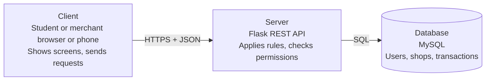
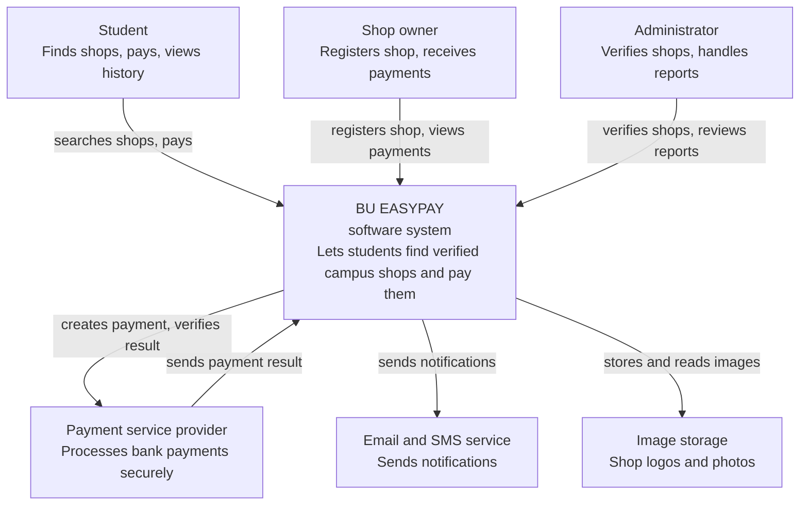
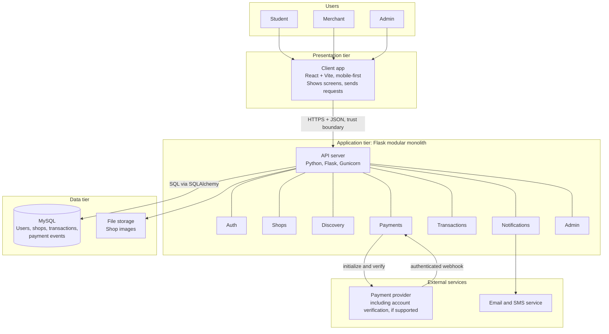
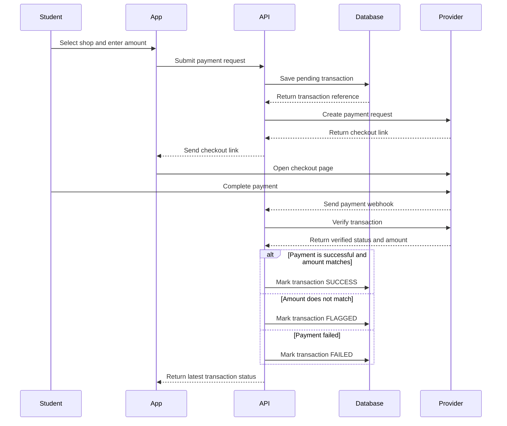
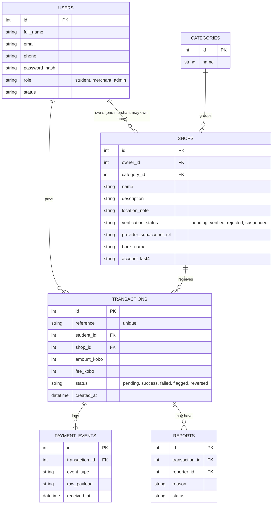

# 02 – Architecture: BU EASYPAY

**Project:** BU EASYPAY, digital payment and shop discovery platform for students
**Input:** `01-prd.md` (Week 4 PRD)
**Status:** Proposed (v1, for review)

> This document turns the PRD from *what* we are building into *how* we build it. Every decision below is tied to a PRD requirement, and every ADR lists the alternatives, the cost and a review trigger.

---

## 1. From PRD to Architecture

| PRD input | Architecture decision it drives |
|---|---|
| Functional requirements | Which backend components we need (Section 4) |
| Non-functional requirements (security, performance, usability, reliability, scalability) | Technology choices and the security design (Sections 7 and 9) |
| MVP scope and priorities | What we build first, and what is isolated behind a switch (Section 3 and ADR-003) |
| Stakeholders and users | Who the system talks to (Section 5) |
| Open questions | Decisions recorded as ADRs, or explicitly deferred (Section 11) |
| Survey findings (paper bank details, fake receipts, no shop visibility) | Why verified merchant payment details and provider-confirmed payments are the core of the design |

### Requirement IDs used in this document

The PRD lists requirements without numbers. We number them here so the design can point back to them.

| ID | Requirement (from PRD) |
|---|---|
| FR-01 | A user can register |
| FR-02 | A user can log in and log out |
| FR-03 | A merchant can apply and register a shop (and an admin verifies it) |
| FR-04 | A student can search shops by name and category and view a shop profile |
| FR-05 | A student can initiate a payment to a registered shop |
| FR-06 | The system processes the payment through a payment provider |
| FR-07 | The system displays transaction status |
| FR-08 | The merchant receives a payment notification |
| FR-09 | A user can view transaction history |
| FR-10 | An administrator manages accounts, verifies shops and handles reported problems |

---

## 2. Client-Server: where a student's request goes

Example: a student searches for a printing shop. The client sends `GET /api/shops?q=print&category=printing`. The server validates the query, asks MySQL and returns the matching shops as JSON. **The client never talks to the database directly.**

---

## 3. Architectural style: modular monolith

BU EASYPAY is one Flask application deployed as one unit, split into clear modules (Section 4). Payments is the riskiest module, so it is built to be switchable.

| | Monolith | **Modular monolith** | Microservices |
|---|---|---|---|
| Deployment | One unit | **One unit** | Many services |
| Team size | Small | **Small to medium** | Several teams |
| Complexity | Low | **Medium** | High |
| Scaling | Whole app | **Whole app** | Per service |
| Best when | Starting out | **Growth expected** | Proven need |

**Why:** small team, requirements that may still change after research, and one shared database. Microservices would add network failures and deployment work we cannot afford. See **ADR-001**.

**Confirmed MVP scope.** The team has confirmed that students must be able to initiate payments through BU EASYPAY. Payments is therefore part of the intended MVP, alongside Shop Discovery, and is designed as a separate module. The payment provider is not yet selected, so provider onboarding, bank-transfer settlement, fees and technical capabilities remain implementation dependencies to validate before launch. Keep `PAYMENTS_ENABLED` as an operational control for testing or temporarily disabling the integration if the provider is unavailable; it does not mean payment has been removed from the agreed MVP scope. See **ADR-003**.

---

## 4. Layers, steps and components

### 4.1 Layers (the structure of the backend)

A request passes through five layers in a fixed order.

| Layer | Flask equivalent | Job |
|---|---|---|
| Routes | Blueprints and URL rules | Match method and path to a controller |
| Middleware | Decorators and `before_request` | Authentication, role checks, input validation, rate limiting |
| Controller | View functions | Receive the valid request and send the reply |
| Model / Service | SQLAlchemy models plus service functions | Business rules and database access |
| Database | MySQL | Store the data |

### 4.2 Components (the modules)

| Component | PRD requirements | Responsibility |
|---|---|---|
| **Auth** | FR-01, FR-02 | Register, log in and out, password hashing, tokens, roles (student, merchant, admin) |
| **Shops** | FR-03, FR-04 | Merchant application, shop profile, categories, admin verification status |
| **Discovery (Search)** | FR-04 | Search by name and category, filter to verified shops only |
| **Payments** | FR-05, FR-06 | Create a payment with the provider, confirm it, never store card or login credentials |
| **Transactions** | FR-07, FR-09 | Transaction status and history for students and merchants |
| **Notifications** | FR-08 | Payment-received notification to the merchant, confirmation to the student |
| **Admin** | FR-10 | Verify shops, suspend accounts, review reported transactions |
| **Shared concerns** | all | Validation, error handling, logging, configuration |

Every requirement has exactly one home. Reviews and ratings (open question) have no component yet and are left out of the MVP.

---

## 5. Level 1: System Context Diagram

**What the context tells us:** the proposed design delegates payment processing to an external provider. Whether the provider supports the required merchant onboarding, account verification and settlement model must be confirmed before this flow is treated as implementable.

---

## 6. Level 2: Container Diagram

**Trust boundary.** Everything left of the HTTPS arrow is untrusted. The client never reaches MySQL, never holds provider secret keys, and never decides whether a payment succeeded.

| Container | Technology | Why |
|---|---|---|
| Client app | React (Vite) | Fast to build, mobile-first, reusable components |
| API server | Python, Flask, Gunicorn | Small, flexible, fits a modular layout with Blueprints |
| Database | MySQL (managed) | Relational data and transactions (ADR-002) |
| File storage | Cloud object storage | Safer than storing images on our own server |
| Payment provider | A licensed Nigerian provider (to be confirmed, ADR-003) | Handles money, bank connections and security |

---

## 7. One request, six steps: a student pays a shop

`POST /api/payments` with `{ "shop_id": 12, "amount": 150000, "note": "Printing" }` (amounts are stored in **kobo**, so 150000 = ₦1,500).

| Step | Layer | What happens |
|---|---|---|
| 1 | Routes | Request matched to the payments controller |
| 2 | Middleware | `login_required` and `role: student`, then validate shop id, amount > 0, amount limits |
| 3 | Controller | Receives the valid request and calls the payment service |
| 4 | Service / Model | Checks the shop is **verified and active**, creates a `PENDING` transaction with a unique reference, calls the provider to initialize a payment |
| 5 | Database | MySQL stores the transaction row and its ID |
| 6 | Controller | Returns `201 Created` with the provider's checkout URL and the reference |

A negative amount is stopped at step 2 with a `400`. An unverified shop is stopped at step 4 with a `403`. The provider is never called.

### 7.1 Payment confirmation flow

The student's browser is **not** trusted to say the payment worked. In the proposed payment design, a provider webhook must be authenticated and the transaction independently verified with the provider before the system marks it successful. The exact signature and verification mechanisms depend on the selected provider.

Failure rules built into the flow:

- **Duplicate webhooks** are ignored because the reference is unique and the update is idempotent.
- **Amount mismatch** between our record and the provider result marks the transaction `FLAGGED` for admin review.
- **Student closes the browser** after paying: the webhook still arrives and the status is correct when they return.
- **No webhook arrives**: a scheduled job re-verifies `PENDING` transactions older than a set time.

---

## 8. Data model (high level)

**Confirmed relationship:** one merchant may register and own multiple shops. The `owner_id` foreign key in `SHOPS` links each shop to its merchant, so one user can be associated with many shop records. Enforce merchant-role authorization when creating or managing shops.

Design notes:

- Money is stored as **integer kobo**, never floating point.
- The agreed settlement method is bank transfer to the merchant. The selected provider must be checked for support for merchant bank-account onboarding and bank-transfer payouts/settlement. Store a provider reference rather than full bank details wherever possible; retain only limited account-identifying information where operationally necessary and appropriately protected. Do not assume a provider capability until verified.
- `payment_events` records provider events for audit and dispute handling. Store only the payload fields needed for verification and audit, protect access, and define a retention period; avoid retaining unnecessary personal or sensitive data.
- `fee_kobo` exists now so the fee decision (open question) does not force a schema change later.

---

## 9. Security design (PRD: Payment Security, Acceptance Criterion 7)

| Concern | Design decision |
|---|---|
| Passwords | Hashed with a salted algorithm (Werkzeug/bcrypt). Never stored or logged in plain text |
| Sessions | Short-lived JWT access tokens over HTTPS. Role checked on every protected route |
| Card or bank login details | **Never touch our servers.** The student pays on the provider's hosted checkout |
| Wrong bank details (reported problem) | Prefer provider-supported merchant account verification during onboarding. This capability and its availability must be confirmed with the selected provider before it is promised. |
| Fake receipts (reported problem) | A payment is `SUCCESS` only after the provider event is authenticated and the transaction is verified server-side. Merchants see status inside the app |
| Webhooks | Signature verified, replay and duplicates ignored, endpoint accepts provider only |
| Input | Validated server-side (type, range, length). SQLAlchemy parameterised queries prevent SQL injection |
| Secrets | Provider keys and `DATABASE_URL` in environment variables, never in Git |
| Abuse | Rate limits on login, registration and payment initiation |
| Fraud | Per-transaction and daily limits, `FLAGGED` state for mismatches, admin review queue |
| Privacy | Merchants see only what they need about a payer. Students' transaction history is visible only to them and admins |
| Transport | HTTPS everywhere, CORS limited to our client domain |

---

## 10. How we judge technologies

| Criterion | How it applies to BU EASYPAY |
|---|---|
| Fit to requirements | Payments need transactions and exact money handling, so a relational database is required |
| Team skills | The team can use React and Python/Flask, so we build features instead of learning a stack |
| Ecosystem | Flask, SQLAlchemy and MySQL are widely documented |
| Cost | Check every hosting and provider limit before depending on it. Free plans end |
| Scalability | Campus-sized load for the MVP; the design allows moving to a larger plan without a rewrite |
| Security | One weak point could expose student data or money, so risky parts are bought, not built |
| Risk and lock-in | Provider and database sit behind our own service layer so they can be replaced |

### Language and framework

| | **Python + Flask** | Node.js + Express | Python + Django |
|---|---|---|---|
| Strength | Small, flexible, matches our skills | One language for server and web | Built-in admin, many features |
| Trade-off | Structure is our job (Blueprints, services) | Team would switch language on the server | Heavier, more to learn for an MVP |

**Pick:** Flask. We give up Django's built-in admin, so we build a small admin module (FR-10) ourselves.

### Hosting options

| | Managed platform | Virtual server | Serverless |
|---|---|---|---|
| Who runs it | The provider | You | The provider |
| Setup effort | Minutes, connect GitHub | Hours: install, secure, patch | Moderate: split into functions |
| Scaling | Pick a bigger plan | Add machines yourself | Automatic, with limits |
| Cost pattern | Fixed monthly plan | Fixed monthly machine | Pay per request |
| Watch out for | Free plans may sleep | Security patches are yours | Cold starts, time limits |
| BU EASYPAY | **Flask API and managed MySQL** | Too much upkeep for a payments system | Awkward for a long-lived Flask app and webhooks |

### Hosting plan: from laptop to live

1. **Push to GitHub.** Code lives in a repository.
2. **Platform builds it.** Installs dependencies and starts Flask with Gunicorn. The React app is built and served as a static site.
3. **Add MySQL.** Set `DATABASE_URL` and the provider keys as environment variables.
4. **Live on HTTPS.** A public URL. Webhooks from the provider can now reach us.

**Why a managed platform first:** less to run, deploys on every push, HTTPS and logs built in, and a payment webhook needs an always-on public URL (a laptop cannot receive it). **Pick a region close to Nigeria** if one is offered, and check the current free limits before relying on them.

**When we would move:** costs grow faster than usage, we need more control of the machine, or one module must scale alone.

---

## 11. Build vs Buy

| Capability | Decision | Why |
|---|---|---|
| Payment processing | **Buy:** licensed payment provider | Money and card or bank data are risky. Provider handles compliance |
| Merchant account verification | **Buy if supported:** through the selected provider | Avoids building a sensitive verification process; confirm provider capability and onboarding rules first |
| Email and SMS notifications | **Buy:** notification service | Delivery is specialised |
| Image storage | **Buy:** cloud object storage | Safer than our own server |
| Hosting and MySQL | **Buy:** managed platform | Less to run for a small team |
| Authentication | **Build thin, on proven libraries** (Flask-JWT/PyJWT, Werkzeug hashing) | Simple email-and-password MVP. Wrapped in our middleware so a hosted auth service can replace it |
| Shop directory and search | **Build** | This is what makes the product different |
| Transactions, history and admin review | **Build** | Product rules and our own data |

*Build what makes your product different. Buy what is common and risky.*

---

## 12. Open questions from the PRD: where each lands

| PRD open question | Architectural answer |
|---|---|
| Which banks will support BU EASYPAY? | Depends on the chosen provider. Verify provider coverage during the feasibility check (ADR-003 review trigger) |
| Registration fee for shop owners? | Business decision. Not needed by the architecture (`shops` has no billing dependency) |
| Fee per transaction? | Business decision. `fee_kobo` and provider split settings support either choice |
| Failed or reversed payments? | `FAILED` and `REVERSED` statuses, `payment_events` log, merchant and student see the state. Refund policy to be decided with the provider |
| Protection against fraud? | Section 9: limits, flagging, signature checks, admin review |
| How do merchants verify a payment succeeded? | In-app status that changes only on provider-confirmed result, plus notification (Section 7.1) |
| Shop ratings or reviews? | Out of MVP. A `reviews` module can be added later without touching Payments |

---

## 13. Non-functional requirements: how the design meets them

| PRD quality | Design response | Proposed target (to confirm) |
|---|---|---|
| Security | Section 9 | No card or bank login data stored; all traffic over HTTPS |
| Performance | Indexed search on shop name and category; pagination | Search results in under 2 seconds on a normal campus connection |
| Usability | Mobile-first React UI, clear error messages for failed payments (Acceptance Criterion 8) | A new student finds a shop and starts a payment in a few taps |
| Reliability | Webhook plus scheduled re-verification, idempotent updates, database backups | No payment left stuck in `PENDING` without a retry |
| Scalability | Stateless API, modular boundaries, managed database | Campus-wide use; any module can later become a service |

---

## 14. Architecture Decision Records

### ADR-001: Use a modular monolith

- **Status:** Proposed
- **Context:** Small team, requirements still being validated by research, one shared database, seven modules.
- **Decision:** One Flask application with separate modules (Auth, Shops, Discovery, Payments, Transactions, Notifications, Admin). Modules call each other only through defined service functions.
- **Alternatives:** A plain monolith; microservices.
- **Consequences:** Simple to deploy and debug. Boundaries must be kept by discipline. The app scales as one unit.
- **Review trigger:** Search or Payments must scale alone, several teams release separately, or modules start breaking each other.

### ADR-002: Use MySQL as the database

- **Status:** Proposed
- **Context:** Related data (users, shops, transactions, reports), payments need transactions and exact amounts, the team already works with MySQL.
- **Decision:** MySQL, hosted as a managed service, accessed only through SQLAlchemy models, with schema changes through migrations.
- **Alternatives:** PostgreSQL; MongoDB.
- **Consequences:** Joins, transactions and constraints keep money data correct. Built-in full-text indexes cover name search. We write migrations and manage connections. PostgreSQL has richer search features if we ever need them.
- **Review trigger:** Search outgrows MySQL full-text, or the hosting provider's managed MySQL cost or limits become a problem.

### ADR-003: Use a hosted payment provider, behind a feature flag

- **Status:** Proposed. Payment is confirmed as an MVP capability; provider not yet chosen.
- **Context:** The team has confirmed that students can initiate payments in the MVP. Merchants are to receive funds through bank transfer. The provider must support the required payment flow and merchant settlement model. Card and bank data are risky to handle directly.
- **Decision:** Integrate one suitable, appropriately licensed provider through our own `PaymentProvider` interface. The student initiates payment through the provider's hosted checkout or supported payment interface. The provider must support settlement to each merchant's bank account by bank transfer, subject to its onboarding, eligibility and regulatory requirements. Payment success is decided only from an authenticated provider notification and server-side verification. `PAYMENTS_ENABLED` is an operational control, not a change to the agreed MVP scope.
- **Alternatives:** Direct bank transfer with manual confirmation (today's problem); collecting bank details and charging ourselves (unacceptable risk); wallet system where BU EASYPAY holds funds (regulatory burden).
- **Consequences:** We never hold funds or card data. We depend on the provider's uptime, fees and onboarding rules (a registered business may be required). The interface lets us replace the provider.
- **Review trigger:** No suitable provider can onboard campus merchants and settle funds to their bank accounts, or provider fees and requirements make the agreed payment flow impractical. Escalate the constraint to the team rather than silently treating payments as out of scope.

### ADR-004: Host on a managed platform

- **Status:** Proposed
- **Context:** Small team, payment webhooks need an always-on public HTTPS URL, limited time for server maintenance.
- **Decision:** Flask API and managed MySQL on a managed platform; React client as a static site; secrets in environment variables.
- **Alternatives:** Virtual server; serverless.
- **Consequences:** Fast deploys and built-in HTTPS and logs. Free plans may sleep, which can delay webhook handling, so a paid plan is likely needed for payments.
- **Review trigger:** Costs grow faster than usage, we need machine-level control, or one module must scale on its own.

---

## 15. Risks to the design

| Risk | Impact | Mitigation |
|---|---|---|
| Payment provider cannot onboard the platform or campus merchants | Payment functionality cannot launch as designed | Verify provider requirements early; compare suitable providers and document any constraint for the team before launch |
| Merchants will not register | Directory is empty | Onboard a small set of real shops before launch. Research needed (PRD assumption) |
| Free hosting sleeps and misses webhooks | Payments stuck in `PENDING` | Paid plan for the API and scheduled re-verification job |
| Fraudulent or mistaken payments | Loss of trust | Limits, flagging, clear reversal process |
| Scope grows (ratings, wallets) | Delays | Keep MVP to the PRD priorities (Section 3) |

---

## 16. Assumptions and decisions requiring confirmation

The following product decisions have been confirmed by the team. Provider and operational details still require verification before implementation:

| Item | Current assumption | Confirmation needed |
|---|---|---|
| Merchant-to-shop relationship | One merchant may register and own multiple shops; the ER diagram uses a one-to-many relationship. | Implement and enforce ownership permissions for each shop. |
| Merchant settlement | Merchants receive funds through bank transfer. | Confirm that the selected provider supports merchant onboarding and bank-transfer settlement, including fees, timing, eligibility and reversal handling. |
| Bank-account verification | The provider may offer account-name or account-ownership verification | Confirm availability and the exact verification process. |
| Payment scope | Students can initiate payments through BU EASYPAY in the MVP. | Confirm the provider, payment methods, fees, failure/reversal handling and operational readiness before launch. |
| Notifications | Email and/or SMS may be used | Confirm the required channels, costs and provider. |
| Shop images | Images will be stored in managed object storage | Select a provider and define upload limits, access controls and retention. |
| Hosting and database | Managed hosting and managed MySQL are preferred | Select providers, region, backup policy, availability target and budget. |

**Final submission check:** ensure the diagrams render in the target GitHub Markdown viewer, confirm the assumptions with the team, and make sure every ADR records its status, context, decision, alternatives, consequences and review trigger.
